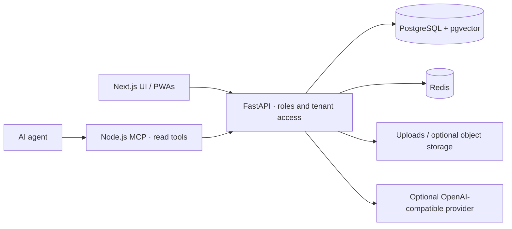

<p align="center">
  
</p>

<h1 align="center">FlintPlate</h1>

<p align="center"><strong>Restaurant operations — menus, floor, orders and team — you host yourself.</strong></p>

<p align="center">
  <a href="LICENSE"></a>
  
  
  
  
  <a href="CONTRIBUTING.md"></a>
</p>

<p align="center">
  <a href="https://neurofunken.de"></a><br>
  <sub>a neurofunken project</sub>
</p>

---

FlintPlate is a standalone, self-hostable restaurant operations product on a Palmscout staffing base. It manages menus, service, guests and teams. FireFlint keeps its separate menu-import adapter; FlintPlate is useful on its own.

> **Status:** early open-source release. FlintPlate is not a certified POS or payroll system and does not charge payments.

## Contents

[Features](#features) · [Architecture](#architecture) · [Quick start](#quick-start) ·
[Configuration](#configuration) · [AI providers](#ai-providers-vendor-neutral) ·
[MCP server](#mcp-server) · [Agent skill](#agent-skill) · [Documentation](#documentation)

## Features

- Menus and price lists, orders and kitchen flow.
- Floors, rooms and tables; reservations with explainable table suggestions.
- Guest and team PWAs, tips and guestbook.
- Ingredients/allergens, staffing and shift coordination on a Palmscout base.
- Optional FireFlint menu snapshot integration and scoped device API.
- Read-only MCP server and agent skill for assisted operations.

## Architecture



More: [architecture](docs/ARCHITECTURE.md).

## Quick start

```sh
# Requirements: Docker Compose, Python 3, Node.js 24
python3 scripts/setup-local.py  # generates local secrets in .env.flintplate
# Add optional settings from .env.example; keep the generated secrets.
docker compose -f compose.yaml --env-file .env.flintplate build api
docker compose -f compose.yaml --env-file .env.flintplate up -d db redis
docker compose -f compose.yaml --env-file .env.flintplate run --rm migrate
docker compose -f compose.yaml --env-file .env.flintplate up -d api
cd frontend
npm ci
npm run build -- --webpack
npm run start -- --hostname 127.0.0.1 --port 3012
```

UI: `http://localhost:3012/gastro` · Team: `/team` · Guest PWA: `/kunden/<venue_id>`.
API docs: `http://localhost:8012/docs`. Create fictional local demo records with
`docker compose -f compose.yaml --env-file .env.flintplate exec -T api python -m scripts.seed_flintplate`.
See [local operation](docs/LOKALER_BETRIEB.md) for account output and stopping.
Use the dedicated `compose.yaml`; inherited `docker-compose*.yml` files describe the old staffing stack.

Compose passwords such as `hireos_secret` and `redis_secret` are development-only; change them for any real deployment. QuickWork and associated seed/test names are fictional demo data. The product logo is a placeholder, not the final mark.

## Configuration

| Variable | Purpose |
| --- | --- |
| `DATABASE_URL` | PostgreSQL asyncpg URL; use an isolated test database for tests |
| `REDIS_URL` | Redis URL including configured password |
| `SECRET_KEY` | Random signing key; replace the example before starting |
| `APP_ENV`, `ALLOWED_ORIGINS`, `FRONTEND_URL` | Environment and permitted browser origins |
| `LEGAL_*` | Operator details and review status; blank fields keep legal pages in draft |
| `OPENAI_API_KEY`, `OPENAI_BASE_URL`, `OPENAI_MODEL` | Optional OpenAI-compatible provider |
| `AI_MOCK_MODE`, `AI_MAX_TOKENS`, `AI_REQUESTS_PER_MIN` | Offline fallback, token budget and process-local throttle |
| `FLINTPLATE_BASE_URL`, `FLINTPLATE_TOKEN`, `FLINTPLATE_READ_ONLY` | MCP client environment; read-only defaults to true |

See [.env.example](.env.example) and [configuration](docs/CONFIGURATION.md). `HIREOS_*` port variables and `hireos_*` compose/database names are legacy technical identifiers.

## AI providers (vendor-neutral)

Optional AI uses OpenAI-compatible Chat Completions; set a base URL, model and provider key where required. Local endpoints can run without a real key. `AI_MOCK_MODE=true` skips remote client construction.

| Provider | `OPENAI_BASE_URL` | Example `OPENAI_MODEL` | Key |
| --- | --- | --- | --- |
| OpenAI | `https://api.openai.com/v1` (or unset) | `gpt-4o-mini` | Required |
| Mistral | `https://api.mistral.ai/v1` | `mistral-small-latest` | Required |
| OpenRouter | `https://openrouter.ai/api/v1` | `openai/gpt-4o-mini` | Required |
| Ollama | `http://127.0.0.1:11434/v1` | `llama3.2` | Optional locally |
| LM Studio | `http://127.0.0.1:1234/v1` | Your loaded model ID | Depends on server auth |
| vLLM | `http://127.0.0.1:8000/v1` | Your served model ID | Depends on server auth |

Examples and data handling: [AI providers](docs/AI-PROVIDERS.md).

## MCP server

Package `@flintplate/mcp`, executable `flintplate-mcp`; dependency-free Node.js 20+ stdio.
Run from the checkout; no registry publication is assumed. [Tools and safety](mcp/README.md).
All exposed tools are read-only. `FLINTPLATE_READ_ONLY=true` is the default.

### Claude Desktop, Cursor and generic MCP JSON

Place this entry in your client's MCP configuration (for Cursor, `.cursor/mcp.json`).
Replace the absolute path and token locally, never in committed files.

```json
{
  "mcpServers": {
    "flintplate": {
      "command": "node",
      "args": [
        "/absolute/path/to/flintplate-oss/mcp/src/server.mjs"
      ],
      "env": {
        "FLINTPLATE_BASE_URL": "http://127.0.0.1:8012",
        "FLINTPLATE_TOKEN": "<access-token>",
        "FLINTPLATE_READ_ONLY": "true"
      }
    }
  }
}
```

### Claude Code

```sh
claude mcp add flintplate --env FLINTPLATE_BASE_URL=http://127.0.0.1:8012 --env FLINTPLATE_TOKEN='<access-token>' --env FLINTPLATE_READ_ONLY=true -- node /absolute/path/to/flintplate-oss/mcp/src/server.mjs
```

### Codex

Add to your local MCP configuration:

```toml
[mcp_servers.flintplate]
command = "node"
args = ["/absolute/path/to/flintplate-oss/mcp/src/server.mjs"]
env = { FLINTPLATE_BASE_URL = "http://127.0.0.1:8012", FLINTPLATE_TOKEN = "<access-token>", FLINTPLATE_READ_ONLY = "true" }
```

## Agent skill

[skills/flintplate/SKILL.md](skills/flintplate/SKILL.md) teaches identity/scope checks, minimal reads and
human approval for any future destructive or publish operation. Copy the folder into your
agent's skill directory. [Setup and local-model use](docs/MCP-AND-SKILLS.md).

## Documentation

| Document | Topic |
| --- | --- |
| [Architecture](docs/ARCHITECTURE.md) | Components and boundaries |
| [Configuration](docs/CONFIGURATION.md) | Environment, deployment and tests |
| [AI providers](docs/AI-PROVIDERS.md) | Hosted and local model setup |
| [MCP and skills](docs/MCP-AND-SKILLS.md) | Client examples and operating workflow |
| [German documentation](docs/README.de.md) | Product and local operation |
| [Guestbook](docs/KUNDENBUCH.md) · [AI decisions](docs/KI-ENTSCHEIDUNGEN.md) | Restaurant workflows (German) |
| [Menu snapshot](docs/FIREFLINT-MENU-SNAPSHOT-V1.md) | FireFlint interoperability |

## Contributing

Please read [CONTRIBUTING.md](CONTRIBUTING.md) and the [Code of Conduct](CODE_OF_CONDUCT.md).
Report vulnerabilities privately through [SECURITY.md](SECURITY.md).

## License

[MIT](LICENSE) © 2026 Hanns Leonhard Osterbrink / neurofunken.

## Kurzfassung (Deutsch)

FlintPlate ist eine selbst hostbare Gastrosoftware für Speisekarten, Raum/Tischplanung, Bestellungen, Reservierungen, Gäste und Team. Eigenständiges Produkt auf einer Palmscout-Personalbasis; keine zertifizierte Kassen-/Lohnlösung und keine Zahlungsabbuchung. KI ist optional und anbieterneutral. MCP und Agent Skill unterstützen lesende Arbeitsabläufe.
Ausführlicher: [deutsche Dokumentation](docs/README.de.md).
