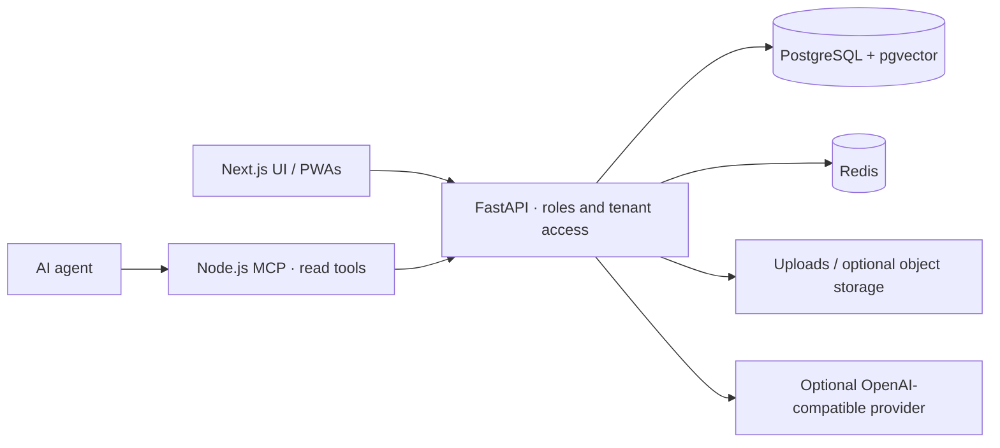

# FlintPlate architecture

`frontend/` is the Next.js/React TypeScript application. `backend/app/main.py` assembles
FastAPI routers. PostgreSQL stores domain records and pgvector embeddings; Redis supports
background/realtime infrastructure. Alembic owns schema migrations. Uploads and optional
object storage must be backed up alongside the database. Optional invoice validation runs
in its own service; see `services/invoice-validator/`.

FlintPlate is a standalone restaurant product built on a Palmscout staffing base. `/gastro` exposes venues, floor/table management, menus, reservations and orders; `/guest/v1` supports guest operations and `/device/v1` provides scoped device integration. The team and guest PWAs share the API. The optional FireFlint menu snapshot contract remains in `docs/FIREFLINT-MENU-SNAPSHOT-V1.md`; FireFlint owns its menu-import adapter. Neither product requires moving that adapter into this tree.

The MCP process is a separate authenticated HTTP client, not a database client. It exposes a
small read-only route inventory and forwards the operator's bearer token. It never grants
permissions beyond the current account. The shared AI client uses optional base URL, key and
model settings; mock mode prevents client construction.

The local runtime uses separate owner/migration and restricted API database roles. Run the administrative migration job before the API. Existing journal protections are not fiscal certification. Guest/team PWAs provide an offline page, not offline order storage or automatic replay.

This is an early pilot codebase. Presence of a route or integration is not certification,
a production readiness guarantee, or permission to process personal data.
